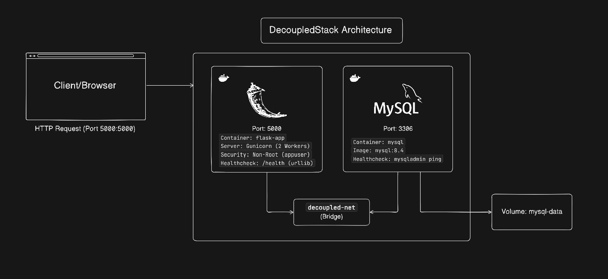

# DecoupledStack — Containerized Two-Tier Web Architecture

A production-ready, decoupled two-tier web application engineered with **Flask**, **Gunicorn**, and **MySQL 8.4** running on an isolated Docker bridge network (`decoupled-net`).

This project demonstrates containerization best practices, least-privilege security, layer caching optimization, custom DNS service discovery, and resilient health monitoring.

---

## 🏗️ Architecture Overview

The application separates concerns between a stateless web presentation tier and a stateful relational database tier:



---

## 🌟 Production-Ready Dockerfile

The included Dockerfile incorporates core containerization and security patterns:

1. **Leveraging Layer Caching**:
   `requirements.txt` is copied and installed *before* copying the application source code (`COPY . .`). Changes to application code will not invalidate dependency layers, drastically speeding up subsequent builds.
2. **`--no-cache-dir` Optimization**:
   Running `pip install --no-cache-dir` prevents pip from saving temporary tarballs and installer packages inside the image layer, significantly shrinking container footprint.
3. **Least Privilege Principle (Non-Root Security)**:
   A dedicated system user `appuser` is provisioned via `useradd --system --create-home appuser`. Files are copied with `COPY --chown=appuser:appuser . .`, and runtime execution switches to `USER appuser`. In the event of an application vulnerability exploit, attackers are confined to an unprivileged container environment.
4. **Zero-Dependency Python Healthcheck**:
   Minimal base images like `python:3.13-slim` do not include `curl` or `wget`. Instead of bloating the container with external OS utilities, a native inline Python probe queries the endpoint:
   ```dockerfile
   HEALTHCHECK --interval=30s --timeout=5s --start-period=10s --retries=3 \
       CMD python -c "import urllib.request; urllib.request.urlopen('http://localhost:5000/health')"
   ```
5. **Production-Grade WSGI Server (Gunicorn)**:
   Replaces the single-threaded Flask development server (`python app.py`) with Gunicorn worker forks (`gunicorn --bind 0.0.0.0:5000 --workers 2 --timeout 90 app:app`) to properly handle concurrency, request timeouts, and worker recycling.

### 🔎 Code Quality Check Summary

| Metric | Status | Implementation Details |
|---|:---:|---|
| **Layer Caching** | ✅ Passed | Dependencies separated from application source code. |
| **Storage Footprint** | ✅ Passed | `--no-cache-dir` on `python:3.13-slim` eliminates transient installers. |
| **Security (Least Privilege)** | ✅ Passed | Dedicated `appuser` non-root execution with proper ownership. |
| **Resiliency & Probes** | ✅ Passed | Native Python `urllib.request` healthcheck avoiding utility bloat. |
| **Concurrency Handling** | ✅ Passed | Multi-worker Gunicorn server configured with graceful timeouts. |

---

## 📁 Repository Structure & Git Tracking Policy

In accordance with clean repository practices and [.gitignore](file:///E:/PRATIK/Coding/AWS-DevOps/Docker/DecoupledStack%20-%20two-tier-flask-app/.gitignore), local-only configurations and development artifacts are excluded from version control:

```text
DecoupledStack - two-tier-flask-app/
├── docs/
│   └── DecoupledStack_Architecture.png # Architecture diagram
├── templates/
│   └── index.html          # Frontend UI (Jinja2 template with async fetch)
├── .dockerignore           # Excludes .git, cache, and env files from image builds
├── .env.example            # Environment template for credentials
├── .gitignore              # Ignores local secrets, data volumes, and dev artifacts
├── app.py                  # Two-tier Flask backend application & PyMySQL connection logic
├── Dockerfile              # Multi-tier, secure non-root Dockerfile
├── message.sql             # SQL bootstrap script for initial database table creation
├── README.md               # Technical documentation & operational guide
└── requirements.txt        # Pinned Python dependencies (Flask, Gunicorn, PyMySQL, cryptography)
```

---

## 🔌 API Endpoints & Routes

| Method | Endpoint | Description |
|---|---|---|
| `GET` | `/` | Renders the web interface, displays all saved messages, and identifies the serving container hostname. |
| `POST` | `/submit` | Accepts form data (`new_message`), persists the entry in MySQL, and returns `{ "message": "<content>" }`. |
| `GET` | `/health` | Lightweight liveness probe returning `{ "status": "ok" }`. Deliberately decoupled from DB queries so intermittent DB latency does not trigger rolling restarts. |

---

## ⚙️ Environment Configuration

The application configures its database connection dynamically from environment variables:

| Variable | Default Fallback | Purpose |
|---|---|---|
| `MYSQL_HOST` | `localhost` (`mysql` in Docker network) | Hostname or container alias of the database server. |
| `MYSQL_PORT` | `3306` | Port exposed by the MySQL database instance. |
| `MYSQL_USER` | `default_user` | Application database username. |
| `MYSQL_PASSWORD` | `default_password` | Application database user password. |
| `MYSQL_DB` | `default_db` | Target database schema name inside MySQL. |
| `FLASK_DEBUG` | off (`0`) | Enables interactive debug mode when launched via `python app.py`. |

---

## 🚀 Deployment Guide

### Option 1: Manual Docker CLI Deployment (Custom Bridge Network)

Deploy the two containers manually on an isolated bridge network using Docker CLI commands.

#### Step 1: Create the isolated bridge network
```bash
docker network create decoupled-net
```

#### Step 2: Build the backend Docker image
```bash
docker build -t two-tier-backend:latest .
```

#### Step 3: Run the MySQL database container
Run MySQL on `decoupled-net`. Note that `MYSQL_DATABASE` is explicitly defined to match the app's database target:
```bash
docker run -d \
  --name mysql \
  --network decoupled-net \
  -v mysql-data:/var/lib/mysql \
  -e MYSQL_ROOT_PASSWORD=root_secure_password \
  -e MYSQL_DATABASE=default_db \
  -e MYSQL_USER=admin \
  -e MYSQL_PASSWORD=root \
  mysql:8.4
```

#### Step 4: Run the Flask application container
Launch the web backend connected to the same `decoupled-net` network:
```bash
docker run -d \
  --name Decoupled-Stack \
  --network decoupled-net \
  -p 5000:5000 \
  -e MYSQL_HOST=mysql \
  -e MYSQL_USER=admin \
  -e MYSQL_PASSWORD=root \
  -e MYSQL_DB=default_db \
  two-tier-backend:latest
```

---

### Option 2: Docker Compose Deployment (Local Orchestration)

If managing the stack locally with Docker Compose, you can define your environment in `.env`:

1. **Configure Environment Variables**:
   ```bash
   cp .env.example .env
   ```

2. **Launch with Compose**:
   ```bash
   docker compose up -d --build
   ```

   The stack configures healthcheck-driven startup ordering:
   ```yaml
   depends_on:
     mysql:
       condition: service_healthy
   ```
   This ensures the Flask application container will not attempt to bind to MySQL until the MySQL health check (`mysqladmin ping`) signals that the database is fully ready to accept connections.

3. **Tear down the stack**:
   ```bash
   docker compose down        # Preserves persistent volume data
   docker compose down -v     # Removes containers and purges database volume
   ```


---

## 🧪 Verification & Runtime Inspection

1. **Verify Health Endpoint**:
   ```bash
   curl -i http://localhost:5000/health
   # Expected response: HTTP/200 OK {"status":"ok"}
   ```

2. **Stream Application Logs**:
   ```bash
   docker logs -f Decoupled-Stack
   ```

3. **Verify Non-Root User Execution**:
   ```bash
   docker exec -it Decoupled-Stack whoami
   # Expected output: appuser
   ```

4. **Inspect Container Health State**:
   ```bash
   docker inspect --format='{{json .State.Health.Status}}' Decoupled-Stack
   # Expected output: "healthy"
   ```

5. **Access the Web Application**:
   Navigate to [http://localhost:5000](http://localhost:5000) in your browser, submit messages through the form, and verify persistence.
